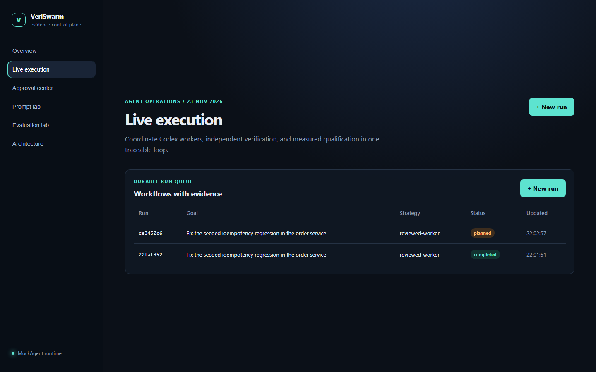
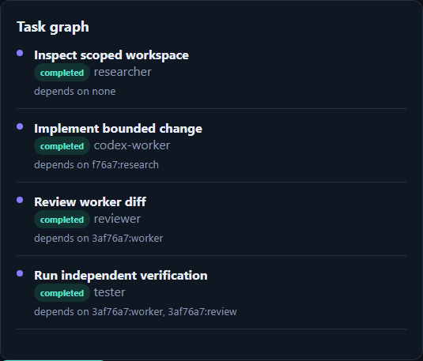
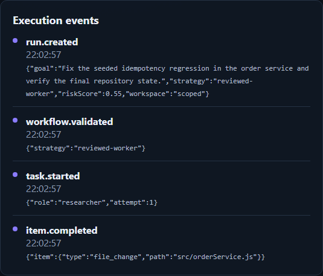
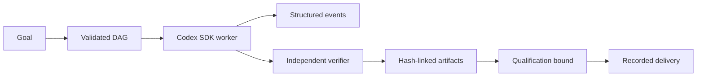

# VeriSwarm

VeriSwarm is an evidence-aware multi-agent orchestration and qualification platform. It wraps a bounded Codex worker in deterministic workflow state, human approval, independent verification, and measurable evaluation.

> Independent research-inspired implementation. Not affiliated with OpenAI, Scale AI, or Salesforce.

## What works now

- Real `@openai/codex-sdk` provider using `Codex.startThread().runStreamed()` with scoped workspace, disabled network search, timeout, approval policy, and event persistence.
- Deterministic `MockAgentProvider` for CI/offline runs; it is explicitly labeled mock and never represents live Codex evidence.
- Durable file-backed store for runs, tasks, events, approvals, artifacts, prompt versions, and evaluation records. PostgreSQL target DDL is in `db/schema.sql`.
- Explicit state transitions, dependency DAG validation, bounded retries, cancellation states, and approval resume/reject behavior.
- Independent verifier executes the fixture test itself, hashes the final workspace, and rejects unauthorized changes. Its evidence records added, changed, deleted, and content-preserving renamed files, reusable allowed-path rules, command exit status, and timeout status.
- Control-plane UI at `http://localhost:4317` when the API is running, with overview, live trace, approvals, prompt lab, evaluation lab, and architecture views.
- Fixture benchmark with strategy comparison and one-sided lower confidence bounds; insufficient samples are reported as inconclusive.

## Runtime visual evidence

The screenshots below were captured from the running local API and browser UI with the explicit `MockAgentProvider` boundary. They are distinct DOM views: the queue, task DAG, and event trace are not copies of one another.

| View | Evidence |
| --- | --- |
| Live execution queue |  |
| Task DAG |  |
| Agent trace |  |

Reproduce the capture with `py -3.12 scripts/capture_browser_evidence.py` while `npm run dev` is running. The script captures only rendered application DOM and does not add annotations or synthetic metrics.

## Run the real working slice

```powershell
npm install
$env:VERISWARM_PROVIDER="mock"
npm run demo
npm run benchmark
npm test
npm run typecheck
npm run dev
```

Open `apps/web/index.html` directly or serve it from a static server while the API runs on port 4317. The API is intentionally separate from the static UI so the frontend always consumes real records.

To opt into a real Codex run, use an authenticated and isolated environment:

```powershell
$env:VERISWARM_PROVIDER="codex"
npm run demo
```

The Codex provider uses `workspace-write`, a temporary workspace, no network access, bounded timeout, and the configured approval policy. It fails explicitly if authentication or the runtime is unavailable. Do not use full host access for ordinary agents.

## Architecture



The full sources are in [`docs/architecture`](docs/architecture/README.md), including system architecture, state machine, execution sequence, approval boundaries, evidence lineage, retries, prompt promotion, benchmark evaluation, ERD, and deployment topology. Rendered assets are intentionally not claimed until a Mermaid renderer is available; the source is kept as the authoritative artifact.

## Demo fixture

`fixtures/order-service` contains an intentional idempotency regression. `npm run demo` copies it into `data/demo/order-service`, runs the provider, independently executes the test, and writes a manifest. The worker's verbal response is not used to decide success.

The verifier is intentionally narrow: the fixture command and allowed paths are explicit, and the final workspace is compared with a pre-run snapshot. A passing worker response cannot bypass a failed test, timeout, deleted test file, or out-of-scope workspace change.

## Research alignment and limits

See [`RESEARCH_ALIGNMENT.md`](RESEARCH_ALIGNMENT.md) and [`EVALUATION_METHODOLOGY.md`](EVALUATION_METHODOLOGY.md). READY's separation of development policy selection from held-out qualification informs the evaluator. CRM-Agent-Bench's stateful assertion pattern informs the fixture. Codex SDK and non-interactive documentation inform the adapter and JSONL fallback. This repository does not claim a CRM-Agent-Bench score, a production qualification, or a novel research result from the small fixture.

## Known limits

This first vertical slice uses a file store and an in-process scheduler. It has no identity provider, production database, Redis queue, Python evaluator, or authenticated live Codex smoke capture. Browser screenshots are now captured for the mock-provider runtime; no video or live-provider claim is made. Those are explicit blockers in [`BLOCKERS.md`](BLOCKERS.md), not hidden behind fake UI claims.
