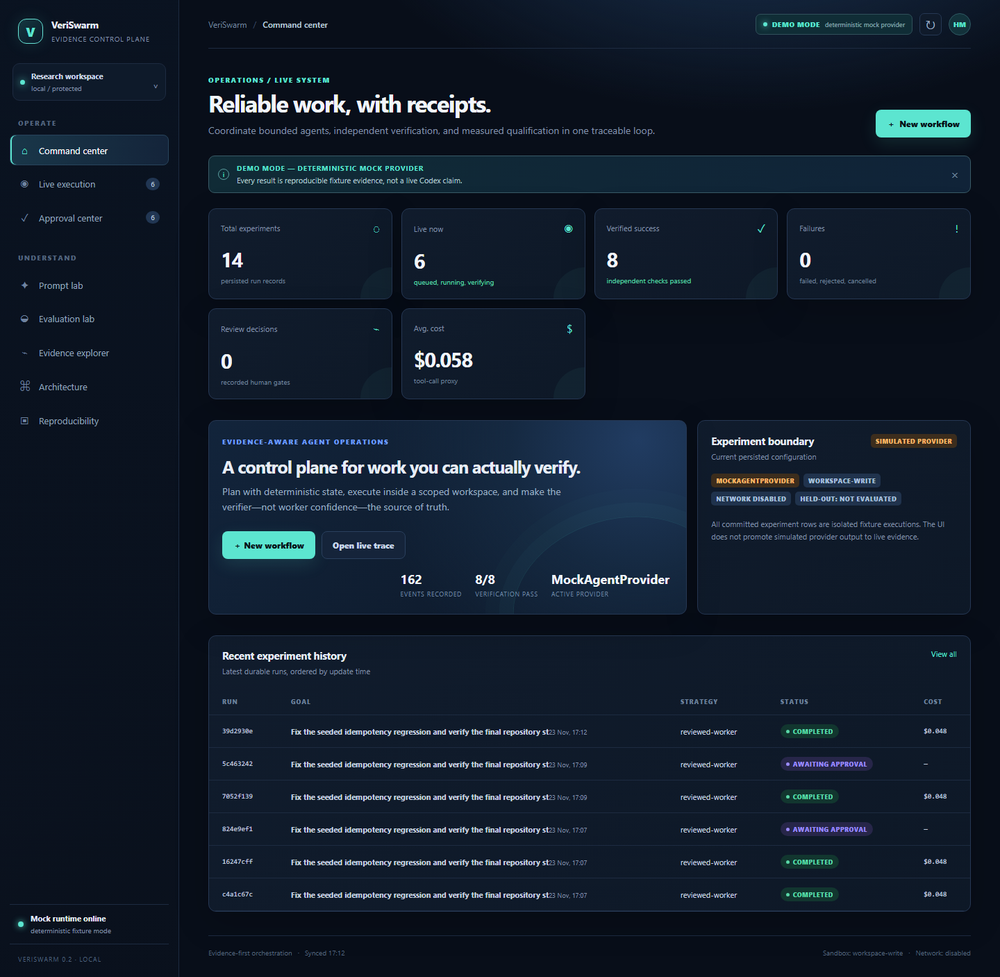
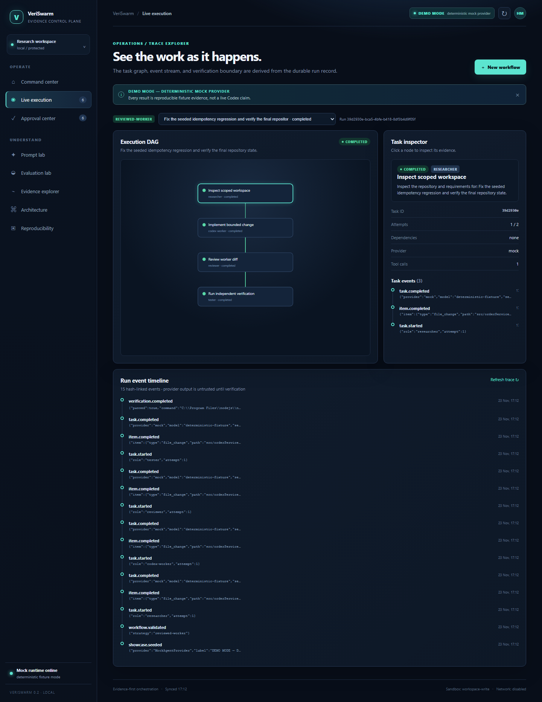
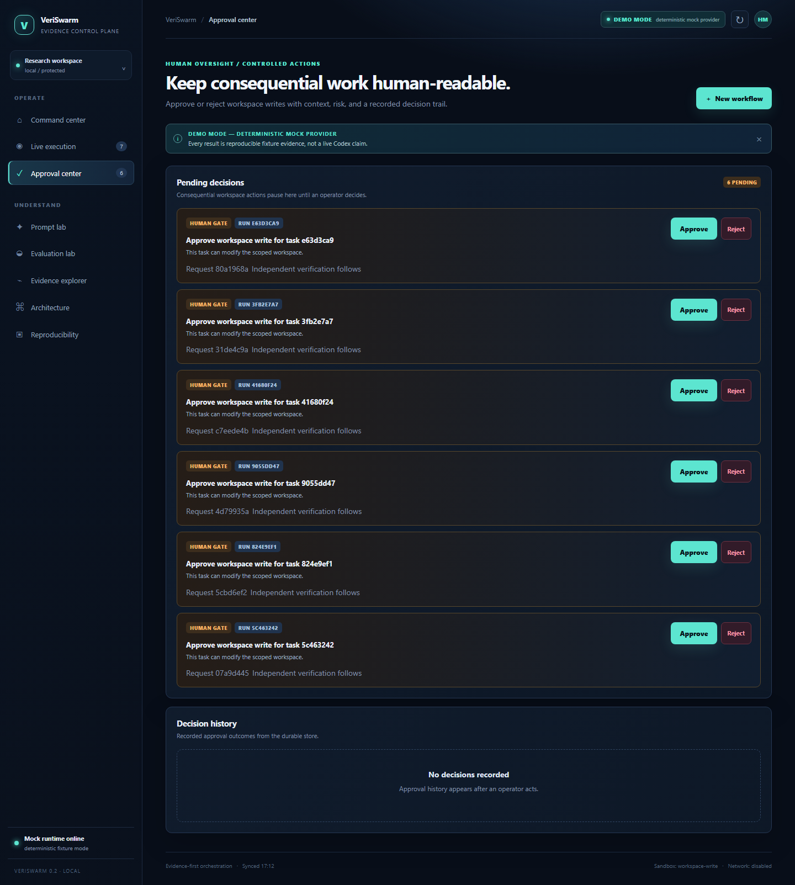
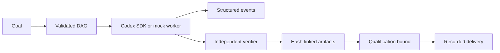

# VeriSwarm — Evidence-Driven Multi-Agent Reliability & Deployment Qualification

VeriSwarm is an evidence-aware multi-agent reliability lab. It wraps bounded workers in deterministic workflow state, human approval, independent verification, and reproducible evaluation. The current implementation demonstrates a functioning evidence and oversight framework; it does not claim a live-model or production qualification result.

> Independent research-inspired implementation. Not affiliated with OpenAI, Scale AI, or Salesforce.

## Product walkthrough

The committed walkthrough is a real Playwright Chromium capture of the local control plane. It uses the deterministic fixture provider, so every frame is reproducible and clearly labelled as mock evidence.


[Download the full research walkthrough MP4](docs/assets/demo/veriswarm-demo.mp4) · [Open the capture manifest](docs/assets/demo/capture-manifest.json)

## What is implemented

- A real `@openai/codex-sdk` provider using `Codex.startThread().runStreamed()` with a scoped workspace, disabled network search, timeout, approval policy, and persisted events.
- A deterministic `MockAgentProvider` for CI, offline development, browser capture, and fixture evidence. Mock output is never presented as live Codex evidence.
- Durable file-backed records for runs, tasks, events, approvals, artifacts, prompt versions, and evaluation results. PostgreSQL target DDL is in [`db/schema.sql`](db/schema.sql).
- Explicit state transitions, dependency DAG validation, bounded retries with recovery events, cancellation, idempotent event persistence, approval resume/reject behavior, and independent verification.
- A generic verifier that executes checks itself, hashes the final workspace, and rejects unauthorized changes, deletions, renames, missing outputs, timeouts, and path escapes.
- A backend-driven dark control plane with command center, live execution DAG, event trace, approval center, prompt lab, evaluation lab, evidence inspector, and architecture map.
- An actual isolated scheduler experiment: 60 development executions across five strategies, with held-out families declared but explicitly reported as `NOT EVALUATED`.
- Rendered Mermaid SVG architecture artifacts under [`docs/assets/architecture`](docs/assets/architecture) generated from [`docs/architecture`](docs/architecture).

## Quick start

```powershell
npm install
$env:VERISWARM_PROVIDER="mock"
npm run benchmark
npm test
npm run typecheck
npm run dev
```

Open [http://localhost:4317](http://localhost:4317). The UI consumes the API's real records; do not open `apps/web/index.html` directly.

To run the optional real Codex path in an authenticated, isolated environment:

```powershell
$env:VERISWARM_PROVIDER="codex"
npm run demo
```

The Codex adapter fails explicitly when authentication or the runtime is unavailable. Ordinary development uses the separated mock provider.

## Browser evidence and diagrams

The committed browser capture can be regenerated with Python 3.12, Playwright, Pillow, and `imageio-ffmpeg`:

```powershell
python -m pip install playwright pillow imageio-ffmpeg
python -m playwright install chromium
npm run showcase
```

`npm run showcase` starts an isolated API, seeds a fixture run and an approval-gated run, asserts the main UI flows in Chromium, captures eleven desktop/mobile screenshots, and produces a 12-second GIF plus a 60–120-second MP4 research walkthrough. It does not claim a live Codex run.

Mermaid sources and their generated SVGs are kept together:

```powershell
npm run diagrams
```

The renderer uses a real headless browser and Mermaid ESM. Set `VERISWARM_MERMAID_URL` to a locally hosted Mermaid module when an offline render is required.

## Control-plane views

| View | Evidence shown |
| --- | --- |
| Command center | API-backed run counts, cost, strategy distribution, verification outcomes, and recent runs |
| Live execution | Actual task dependencies, status transitions, selected task inspector, and event timeline |
| Approval center | Pending decisions plus persisted approve/reject history; mutation requires native confirmation |
| Prompt lab | Immutable prompt versions, hashes, and promotion status |
| Evaluation lab | Benchmark sample sizes, rates, confidence bounds, review burden, cost proxy, and qualification status |
| Evidence explorer | Artifact metadata, verifier record, hashes, event stream, and run selection |
| Architecture | Interactive implementation/proposed boundary map plus rendered source diagrams |







## Architecture



The complete source/rendered set covers system architecture, state machine, execution sequence, approval boundaries, evidence lineage, retries, reliability, prompt promotion, benchmark evaluation, ERD, and deployment topology. Start at [`docs/architecture/README.md`](docs/architecture/README.md).

## Demo fixture and evaluation

`fixtures/order-service` contains an intentional idempotency regression. `npm run demo` copies it into `data/demo/order-service`, runs the selected provider, independently executes the test, and writes a manifest. The worker's verbal response is not used to decide success.

See [`RESEARCH_ALIGNMENT.md`](RESEARCH_ALIGNMENT.md) and [`EVALUATION_METHODOLOGY.md`](EVALUATION_METHODOLOGY.md) for the research framing. This repository does not claim a CRM-Agent-Bench score, a production qualification, or a novel research result from the small fixture.

## Research results and evidence

The latest `npm run benchmark` run executed 60 isolated development cases with `MockAgentProvider`: 12 order-idempotency seeds across five real scheduler workflows. All five strategies verified 100% of this fixture family; measured total cost proxies ranged from `$0.432` for single/planner workers to `$1.200` for parallel adjudication. The seven declared held-out problem families were not run, so the qualification status is `NOT EVALUATED`.

Machine-readable results are in [`reports/`](reports), and the research mapping is in [`docs/research/`](docs/research). The report records provider identity, run IDs, verification exit codes, workspace hashes, review status, recovery events, tool calls, and cost assumptions.

## Truth conditions and limits

- The committed screenshots, GIF, MP4, and evaluation records are deterministic fixture evidence from `MockAgentProvider`.
- The live Codex adapter is implemented but has not been represented as successful evidence without a configured authenticated runtime.
- The current profile uses a file store and in-process scheduler. PostgreSQL/Redis, identity, OpenTelemetry exporters, the Python evaluator, and production deployment are target work rather than shipped infrastructure.
- The repository has a GitHub remote, but this project is not a hosted production deployment. Run it locally at `http://localhost:4317`.

See [`BLOCKERS.md`](BLOCKERS.md) for the explicit boundary between implemented, tested, experimental, and planned behavior.
